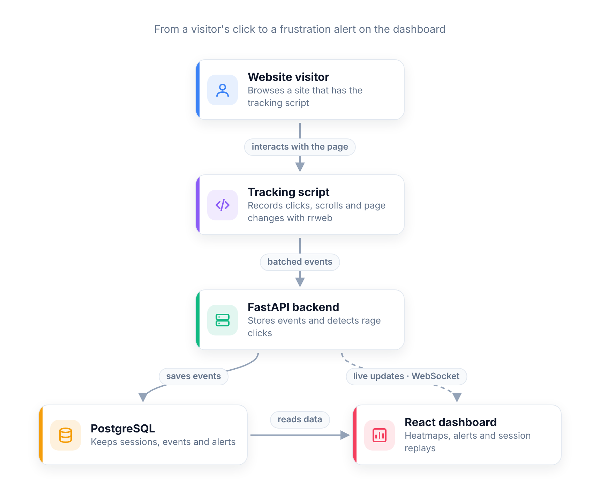

# UX Session Replay Analytics

**See exactly where people get frustrated on your website.**

UX Session Replay Analytics records how real visitors use a website, automatically detects signs of frustration such as **rage clicks** (clicking the same spot again and again when nothing happens), and shows the results on a live dashboard with heatmaps, severity alerts and full session replays.

🔗 **Try the demo:** https://ux-session-replay-analytics.vercel.app/demo.html
📊 **Dashboard:** https://ux-session-replay-analytics.vercel.app

> A patent application has been filed (2026) for the rage-click detection system used in this project.

---

## Try it yourself (about 2 minutes)

1. Open the **[demo store](https://ux-session-replay-analytics.vercel.app/demo.html)**. It's a fictional shop, and your visit is recorded as you use it.
2. Add an item to the cart, then click **Place order** 5 or more times quickly. The button is broken on purpose, like a real checkout bug.
3. Click **Open the dashboard** to see your session appear, the rage-click alert it triggered, and a replay of what you just did.

> **Note:** The backend runs on a free hosting plan that sleeps when idle, so the first session may take up to a minute to appear.

---

## Features

- **Session recording.** A lightweight tracking script records clicks, scrolls, mouse movement and page changes, and sends them to the backend in batches.
- **Automatic rage-click detection.** A sliding-window algorithm flags rapid repeated clicks and grades them by severity: medium, high or critical.
- **Session replay.** Watch a recorded visit play back like a video, with rage-click markers on the timeline so you can jump straight to the moment of frustration.
- **Live dashboard.** New sessions and alerts appear in real time over WebSockets, with no page refresh needed.
- **Click heatmap.** See which areas of a page get the most clicks.
- **Rage Click Alerts.** A list of frustration events sorted by severity.
- **Timeline.** A chronological log of every event in a session.
- **Search and filters.** Find sessions by page URL or date range, and filter any panel down to a single session.
- **Command palette.** Press `/` to jump anywhere in the dashboard.

---

## How it works

<p align="center">
  <picture>
    <source media="(prefers-color-scheme: dark)" srcset="docs/architecture-dark.png">
    
  </picture>
</p>

1. **Record.** The tracking script runs on the website being monitored. It uses [rrweb](https://github.com/rrweb-io/rrweb) to capture the page and user actions, and sends events to the backend in small batches.
2. **Detect.** The backend stores the events and runs the rage-click detector on incoming clicks.
3. **Show.** The dashboard reads sessions, alerts and replays from the backend's REST API, and receives live updates over a WebSocket connection.

### Rage-click detection

A rage click is several clicks on almost the same spot within a short time. The detector uses a **sliding window**: it keeps only the most recent clicks within a time limit, drops older ones as new clicks arrive, and checks whether the remaining clicks are close enough together. The more clicks in the burst, the higher the severity (**medium → high → critical**). The detector is covered by automated unit tests written with Vitest.

---

## Tech stack

| Part | Technologies |
|---|---|
| Dashboard | React, TypeScript, Vite, Tailwind CSS, React Router, Framer Motion, lucide-react |
| Recording and replay | rrweb, rrweb-player (runs in a Web Worker) |
| Backend | Python, FastAPI, REST APIs, WebSockets |
| Database | PostgreSQL (Neon) |
| Testing and CI | Vitest, GitHub Actions |
| Hosting | Vercel (dashboard and demo), Render (backend) |

---

## Project structure

```
├── index.html                # Dashboard entry page
├── demo.html                 # Demo store used for testing
├── src/
│   ├── trackingScript.ts     # Records visitor sessions and sends events
│   ├── rageClickDetector.ts  # Sliding-window rage-click detection
│   ├── rageClickDetector.test.ts
│   ├── replayWorker.ts       # Runs the replay player in a Web Worker
│   ├── ReplayViewer.tsx      # Session replay with rage-click markers
│   ├── Heatmap.tsx           # Click heatmap
│   ├── RageAlerts.tsx        # Severity-sorted alerts
│   ├── useLiveSessions.ts    # Live WebSocket updates
│   └── pages/                # Sessions, Alerts, Heatmap, Timeline pages
└── .github/workflows/ci.yml  # Continuous integration
```

The FastAPI backend is kept in a separate repository.

---

## Running it locally

You need [Node.js](https://nodejs.org/) installed.

```bash
git clone https://github.com/Srinidhi-111/UX-Session-Replay-Analytics.git
cd UX-Session-Replay-Analytics
npm install
```

Create a file named `.env` in the project folder with the address of your backend:

```
VITE_API_URL=http://localhost:8000
```

Then start the development server:

```bash
npm run dev
```

- Dashboard: http://localhost:5173
- Demo store: http://localhost:5173/demo.html

Run the tests:

```bash
npx vitest run
```

---

## Author

Built by **Srinidhi R**.

[Portfolio](https://srinidhi-111.github.io) · [GitHub](https://github.com/Srinidhi-111) · [LinkedIn](https://www.linkedin.com/in/srinidhi-rajesh-kanna-b39150339)
